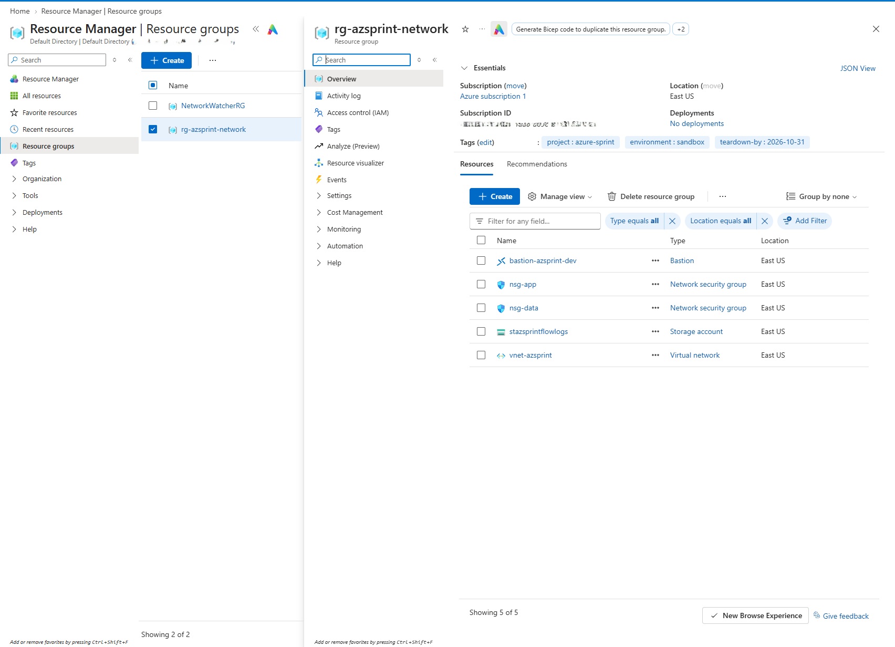
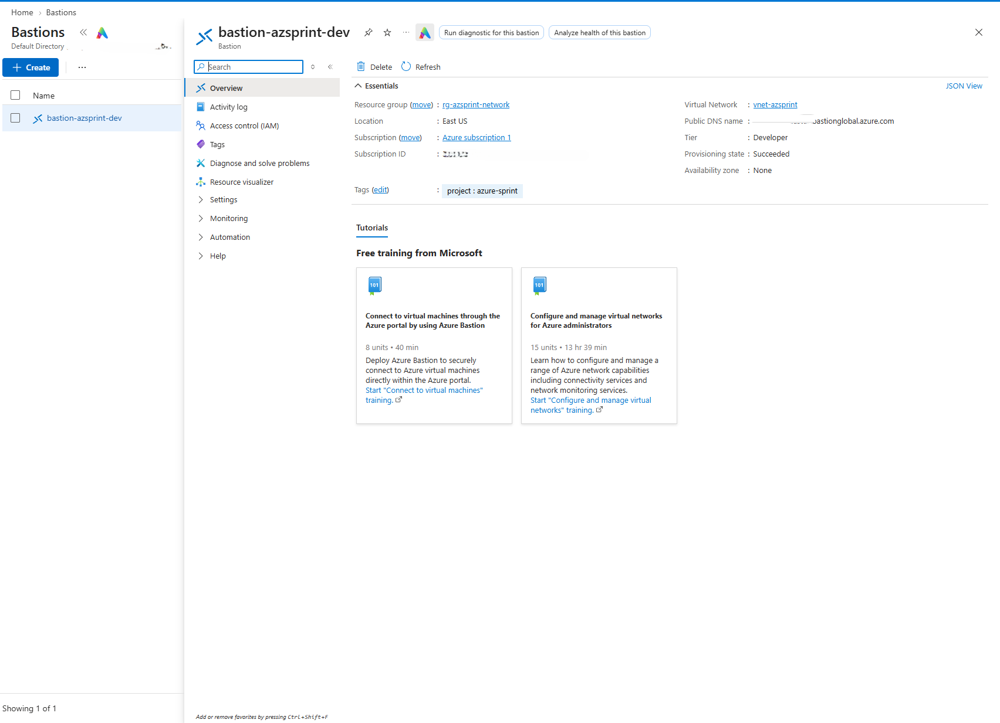
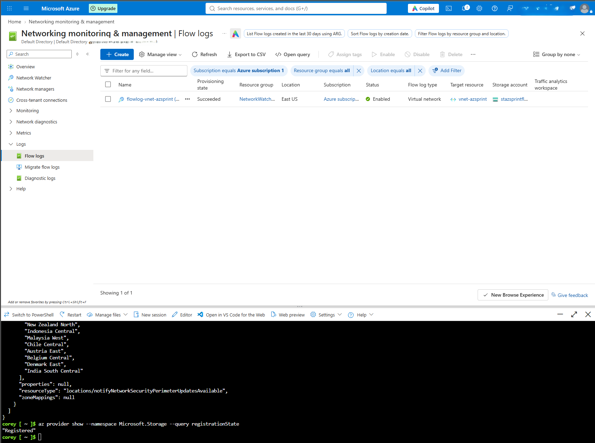

# Azure Network Foundation: VNet, NSGs & Secure Access (Terraform)



## Overview

A secure, least-privilege Azure network foundation built with Terraform: a segmented
virtual network, subnet-scoped firewall rules, VNet-wide traffic logging, and
password-free, portless remote access via Azure Bastion. This is project 1 of a
multi-cloud security portfolio (AWS + Azure) targeting Cloud Security / Cloud
Engineer roles. See the [repo root](../README.md) for the full series.

## Architecture

```
Internet
   |
   | HTTPS (443) only — Allow-HTTPS-Inbound, then Deny-All-Inbound
   v
+--------------------+              +--------------------+
|  snet-app          |   SQL/1433   |  snet-data          |
|  10.20.1.0/24       | -- from --> |  10.20.2.0/24        |
|  nsg-app             |  snet-app   |  nsg-data             |
+--------------------+              +--------------------+
            \                              /
             \                            /
              vnet-azsprint (10.20.0.0/16)
                         |
              Azure Bastion (Developer SKU)
              (browser-based RDP/SSH, no public IP,
               no dedicated subnet required)
                         |
              VNet Flow Logs -> stazsprintflowlogs
              (Network Watcher, 7-day retention)
```

- **`rg-azsprint-network`**: resource group as the security/billing boundary for
  this project. Tagged `project`, `environment:sandbox`, `teardown-by:2026-10-31`.
- **`vnet-azsprint`** (`10.20.0.0/16`): split into an app tier and a data tier,
  each with its own NSG.
- **`nsg-app`**: allows inbound 443 from the internet only, with an explicit
  `Deny-All-Inbound` rule beneath it for audit clarity. It's redundant with Azure's
  implicit deny, but it documents intent explicitly.
- **`nsg-data`**: allows inbound 1433 (SQL) *only* from the app subnet's CIDR
  (`10.20.1.0/24`). Nothing from the internet, same explicit deny-all beneath it.
- **VNet-level Flow Logs**: traffic logging across both subnets, written to
  `stazsprintflowlogs`, with 7-day retention.
- **Azure Bastion (Developer SKU)**: secure portal-based access to future VMs in
  this VNet, with no public IP and no bastion-dedicated subnet.

## Why I built it this way

- **Least-privilege NSG rules, not defaults.** Each tier only accepts the one port
  it needs, from the one source that needs it. The data tier never sees the
  internet at all, only the app subnet's specific CIDR on 1433.
- **VNet-level flow logs, not NSG-level.** I originally built this against
  per-NSG flow logs, which is still the pattern most tutorials show, and hit a
  hard error on `apply`. Turns out Azure retired the ability to create *new*
  NSG-level flow logs in mid-2025. I checked the current guidance directly
  against Microsoft's docs and switched to VNet-level flow logs instead (same
  underlying Terraform resource, just with `target_resource_id` pointed at the
  VNet instead of an NSG). One log stream covers both subnets instead of two.
  Leaving this in as an example of designing against the platform's *current*
  state instead of cached or textbook knowledge.
- **Bastion Developer SKU over Basic/Standard.** It's genuinely free (confirmed
  against Microsoft's pricing page), and unlike the paid tiers, it needs no
  dedicated `AzureBastionSubnet` or public IP. That means secure remote access
  without adding cost or attack surface to a project running on a hard credit
  budget.
- **Scoped service principal, not a subscription-wide one.** Terraform
  authenticates as `tf-ops-azsprint`, holding Contributor only on
  `rg-azsprint-network` plus a narrow Network Contributor grant on the
  Azure-managed `NetworkWatcherRG` (needed only because Network Watcher resources
  live outside the project's own resource group). Not Owner, not subscription-wide
  Contributor.
- **Resource group as a data source, not a managed resource.** Terraform treats
  the resource group as a pre-provisioned boundary it reads, rather than owning
  its lifecycle. That keeps the blast radius of a `destroy` limited to this
  project's resources.

## Tech stack

- Terraform (`azurerm` provider ~> 4.0)
- Azure CLI / Azure Cloud Shell
- Azure Virtual Network, Network Security Groups, Network Watcher, Azure Bastion

## Reproduce this

```bash
git clone https://github.com/coreykcreech/cloud-security-portfolio.git
cd cloud-security-portfolio/azure-01-network-terraform

# Requires an existing resource group + a service principal with Contributor
# on it, exported as ARM_CLIENT_ID / ARM_CLIENT_SECRET / ARM_SUBSCRIPTION_ID /
# ARM_TENANT_ID, plus Network Contributor on NetworkWatcherRG for flow logs.

terraform init
terraform plan
terraform apply
```

## What I'd do differently at scale

- Remote state (Azure Storage backend with state locking) instead of local
  state. Fine for a solo, time-boxed build, not for a team.
- Bastion Standard/Premium with a dedicated `AzureBastionSubnet` once real VMs
  and session logging/recording are in play. Developer SKU is a cost-smart
  choice for a demo, not for production remote access.
- Azure Firewall (or NSG-based egress rules) for outbound traffic control.
  This build only secures inbound.
- Separate environments (dev/prod) via Terraform workspaces or a module +
  `tfvars` per environment, instead of one flat configuration.

## Screenshots




